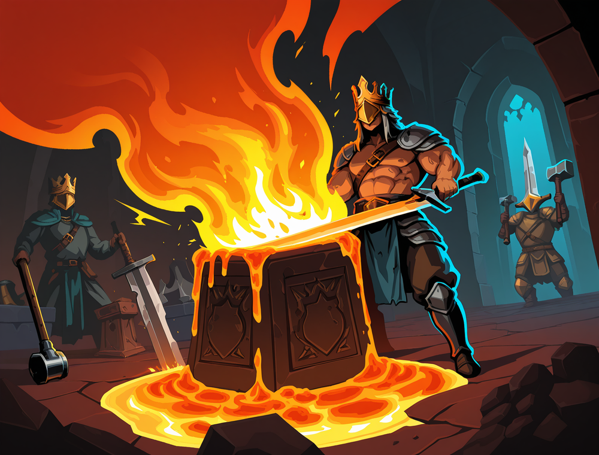

# Sts2-Yiba

《杀戮尖塔 2》（Slay the Spire 2）的角色 / 卡牌 Mod，基于 [BaseLib](https://github.com/Alchyr/BaseLib) 框架开发。

模组内部 ID 为 `Yiba`，显示名 **Yiba-ZaRou**。当前包含 **25 张卡牌**、**12 个能力（Power）** 与 **1 个共享遗物**，并附带若干 Harmony 补丁用于扩展原版未开放的接口。



---

## 特性

- **25 张自定义卡牌**，分布在 Ironclad、Silent、Defect、Regent、Necrobinder 五个职业池与无色池中，可直接在各角色卡池中随机获取。
- **12 个自定义能力**：延续卡牌效果的持续状态（如「赝品」「斗转星移」「同步者·奥斯提」等）。
- **1 个共享遗物**：大葱（Uncommon，进入战斗时获得力量）。
- **Harmony 补丁层**：在不修改原版资源的前提下，接管卡牌标题 / 词条 / 战斗开始与胜利钩子、卡牌费用与打出流程等。
- **动态变量与本地化**：自定义 `DynamicVar`（如「上一次打出的牌」「穿刺概率」）与中文本地化文件，支持游戏内的动态数值显示。

## 卡牌一览

| 卡池 | 卡牌 | 类型 | 稀有度 | 费用 |
| --- | --- | --- | --- | --- |
| Ironclad | 认知障碍 `CognitiveImpairment` | Power | Uncommon | 1 |
| Ironclad | 禁制诅咒 `ForbiddenCurse` | Skill | Rare | 1 |
| Silent | 技杂 `AcrobaticsPlus` | Skill | Common | 1 |
| Silent | 取舍 `TradeOff` | Skill | Common | 0 |
| Silent | 事先预留 `Allocated` | Skill | Uncommon | 0 |
| Silent | 灵敏身姿 `AgilePosture` | Power | Uncommon | 1 |
| Silent | 时机正巧 `PerfectTiming` | Power | Uncommon | 1 |
| Silent | 陷阱木偶 `TrapPuppet` | Skill | Uncommon | 2 |
| Silent | 出千 `HappyOldHome` | Power | Rare | 3 |
| Defect | 轴承 `Bearing` | Skill | Uncommon | 1 |
| Regent | 王不惑 `UnshakenKing` | Skill | Uncommon | 0 |
| Regent | 赝品 `Counterfeit` | Power | Uncommon | 1 |
| Regent | 不放弃！ `NeverGiveUp` | Skill | Rare | 3 |
| Regent | 王铸剑 `KingForge` | Power | Rare | 3 |
| Necrobinder | 痛，太痛了 `TooPainful` | Skill | Uncommon | 1 |
| Necrobinder | 同步者·奥斯提 `SynchronizerOsty` | Skill | Uncommon | 1 |
| Necrobinder | 亡灵赐福 `UndeadBlessing` | Skill | Uncommon | 2 |
| Necrobinder | 为你而战 `FightForYou` | Power | Rare | 1 |
| Necrobinder | 复活吧，我的爱人 `Resurrect` | Skill | Rare | 3 |
| Colorless | 回溯 `Backtrack` | Skill | Uncommon | 1 |
| Colorless | 小丑 `Joker` | Skill | Uncommon | 1 |
| Colorless | 临阵磨枪 `Preparation` | Skill | Uncommon | 1 |
| Colorless | 远见明察 `ForesightAndInsight` | Attack | Rare | 1 |
| Colorless | 穿刺木桩 `PunctureStake` | Attack | Rare | 2 |
| Colorless | 斗转星移 `ReboundMy` | Skill | Rare | 3 |

> 具体数值、升级效果与描述文案见 `Yiba/localization/zhs/cards.json`。

## 遗物

| 遗物 | 稀有度 | 效果 |
| --- | --- | --- |
| 大葱 `Scallion` | Uncommon（共享遗物池） | 每场战斗开始时获得 2 点力量 |

## 环境要求

| 项目 | 版本 |
| --- | --- |
| Slay the Spire 2 | 支持 Mod 的公开版本（Godot 4.5.1 引擎） |
| [BaseLib](https://github.com/Alchyr/BaseLib) | ≥ 3.1.2（本项目编译引用 3.4.8） |
| .NET SDK | 9.0 |
| Godot（MegaDot） | 4.5.1 stable mono — 版本必须与游戏一致，否则 `.pck` 无法加载 |
| NuGet | `Alchyr.Sts2.BaseLib` 3.4.8、`Alchyr.Sts2.ModAnalyzers` 0.1.9 |

> 游戏本体需要安装 BaseLib 前置 Mod，否则加载失败。

## 构建

1. 安装 .NET 9 SDK 与 Godot 4.5.1 mono（MegaDot）。
2. 打开 `Yiba.csproj`，确认以下路径与你的环境一致（脚本会自动探测 Steam 库路径，探测不到时使用默认值）：

   ```xml
   <GodotPath>C:/Users/28610/Desktop/sts2/megadot/MegaDot_v4.5.1-stable_mono_win64.exe</GodotPath>
   <SteamLibraryPath>C:/Program Files (x86)/Steam/steamapps</SteamLibraryPath>
   ```

3. 编译并安装到游戏目录：

   ```bash
   dotnet build          # 输出 Yiba.dll 与 Yiba.json 到 mods/Yiba/
   dotnet publish        # 额外调用 Godot 无头导出，生成 Yiba.pck
   ```

   Linux / macOS 的路径规则写在 `Yiba.csproj` 对应的条件块中，一般无需修改。

4. 构建产物位于 `<Steam>/steamapps/common/Slay the Spire 2/mods/Yiba/`，包含 `Yiba.dll`、`Yiba.json`、`Yiba.pck` 三个文件（缺一不可）。

## 目录结构

```
.
├── MainFile.cs              # Mod 入口，注册 Harmony 补丁
├── Yiba.json                # Mod 清单（ID / 版本 / 依赖）
├── project.godot            # Godot 工程配置
├── Yiba.csproj              # 构建脚本：引用游戏 DLL、复制产物、导出 pck
├── Yiba/                    # Godot 资源目录（打进 .pck）
│   ├── images/              # 卡面、能力与遗物图标（含 big 高清版）
│   └── localization/zhs/    # 中文本地化：卡牌 / 能力 / 遗物 / 提示
└── YibaCode/                # C# 逻辑
    ├── Cards/               # 卡牌，按卡池分目录
    ├── Powers/              # 能力（有持续效果的卡牌状态）
    ├── Relics/              # 遗物
    ├── Patchs/              # Harmony 补丁
    ├── MyDynamicVar/        # 自定义动态变量
    ├── Extensions/          # 资源路径等扩展方法
    └── Tools/               # 辅助工具（音效播放、回合控制等）
```

## 开发说明

- 新增卡牌：在 `YibaCode/Cards/<卡池>/` 下继承 `YibaCard`，用 `[Pool(typeof(XxxCardPool))]` 指定卡池；卡面图片按 `卡牌id小写.png` 放入 `Yiba/images/card_portraits/`（大图放 `big/`）。
- 新增能力：继承 `YibaPower`，图标放 `Yiba/images/powers/`（大图放 `big/`）。
- 新增遗物：继承 `YibaRelic`，图标放 `Yiba/images/relics/`（大图放 `big/`，描边图以 `_outline` 结尾）。
- 所有面向玩家的文本走 `Yiba/localization/zhs/*.json`，键名格式为 `YIBA-<卡牌ID>.title` / `.description`。
- 图标缺失时基类会自动回退到 `power.png` / `relic.png` / `relic_outline.png` 占位图。

## 已知说明

- 目前仅提供简体中文本地化（`localization/zhs`），其他语言会回退到英文键名。
- 部分机制依赖对原版内部方法的 Harmony 补丁（如 `CardModel.OnPlayWrapper`、`Hook.ShouldDie`），游戏本体更新后可能需要跟随调整。

## 致谢

- [BaseLib](https://github.com/Alchyr/BaseLib) — Mod 框架与 API
- MegaDot — 与游戏版本对齐的 4.5.1 mono 版 Godot 编辑器
- MegaCrit — Slay the Spire 2

## 免责声明

本项目为玩家自制同人 Mod，与 MegaCrit Games 无关；游戏素材版权归原公司所有，请勿用于商业用途。

---

### English

A character/card mod for **Slay the Spire 2**, built on [BaseLib](https://github.com/Alchyr/BaseLib). 25 cards across the Ironclad / Silent / Defect / Regent / Necrobinder / Colorless pools, 12 custom powers, 1 shared relic, plus a Harmony patch layer. Requires .NET 9 SDK, Godot 4.5.1 mono (MegaDot) and BaseLib ≥ 3.1.2. Build with `dotnet build` (DLL + manifest) and `dotnet publish` (Godot pack export) — output goes to `Slay the Spire 2/mods/Yiba/`.
